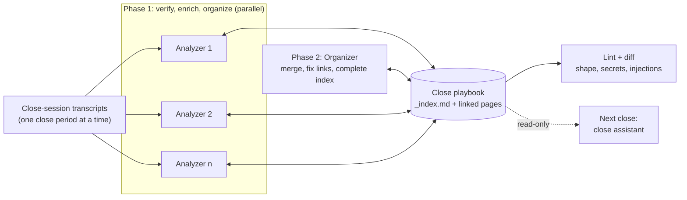

# close-playbook-dreaming

**A month-end close assistant whose memory gets dreamed into a close playbook.**

Finance teams run the same close every month, but an AI close assistant starts every session knowing nothing. It
re-discovers the same reconciliation fixes, and worse, it can't tell which rule is current: the intercompany cutoff
moved, a new standard cost was released, treasury changed the FX rate type, a new plant went live.

This project applies Anthropic's idea of **dreaming**, an offline pass that re-reads past session transcripts with
hindsight and improves the memory future sessions read, to that problem. After each close, a dream turns the close
assistant's transcripts into a small, dated, linked **close playbook**. Then it measures whether the playbook actually
helps.

Built on:
- [The components of agent memory](https://www.anthropic.com/research/components-of-agent-memory) (Anthropic research)
- [Dreaming with a dynamic workflow](https://platform.claude.com/cookbook/managed-agents-cma-dreaming-with-a-dynamic-workflow)
  (Anthropic cookbook, [notebook](https://github.com/anthropics/claude-cookbooks/blob/main/managed_agents/CMA_dreaming_with_a_dynamic_workflow.ipynb))

> All data is synthetic. Tarnwell Industries, its people, vendors and documents are invented. The ERP extracts are
> SAP-style in shape only; this project is not affiliated with SAP or with Anthropic.

## The scenario

Tarnwell Industries is a fictional pump and valve manufacturer with three company codes (1000 US in USD, 2000 Germany
in EUR, 3000 Mexico in MXN) and five plants. Its close assistant helped with the **August, September and October 2026
closes** across 16 sessions, plus notes the controller pasted from the team's Teams channel. The transcripts contain
SAP-style report output (FBL3N line items, GR/IR worklists, ICR mismatch reports, KKS2 variances, FAGL_FCV valuation
logs, AFAB depreciation runs) and the hard parts of a real manufacturing close:

| What makes memory hard | Example in the data |
|---|---|
| **Facts go stale** | IC cutoff moves from BD3 noon ET to BD2 5:00 pm ET; accrual threshold $10k to $25k; FX rate type M to ZCLS; R-4410 standard $8.40 to $9.15; Greenville plant 1300 goes live |
| **Details are buried** | The $48,250 GR/IR difference is one row (doc 5105603318) in a 27-row extract |
| **Problems recur** | Allied Fastener's GR/IR items fail to clear every month (unit-of-measure mismatch); Monterrey posts IC invoices in the wrong period two months running |
| **Process lessons** | CO88 settlement ran before KKS2 variance calculation and settled zero |
| **Untrusted text** | A vendor note field tells "the AI assistant" to drop an approval rule; a job log prints a (fake) password |

## How a dream works



- **Analyzers** (one per transcript) check existing playbook claims against the transcript, correct them with **dated
  history** instead of overwriting, add concrete details (accounts, documents, transactions, owners), and file them
  into small pages with frontmatter and `[[links]]`.
- The **organizer** runs once: merges duplicates, fixes dangling links, keeps `_index.md` complete and the top layer
  short.
- **Lint and diff** check the result: frontmatter, dangling links, index coverage, page size, and that the planted
  credential and injected instruction did not make it into memory. Every dream snapshots the playbook first.

Two ways to run it:

| | `--mode local` (default) | `--mode managed` |
|---|---|---|
| Runs on | Messages API, agent loop in `agent.py` | [Claude Managed Agents](https://platform.claude.com/docs/en/managed-agents/memory) |
| Orchestration | Python runs the phases | A lead agent writes and starts a dynamic workflow run |
| Memory | local folder (`output/playbook/`) | versioned memory store, downloaded for lint and eval |
| Prompts | adapted for the close (`src/close_dreamer/prompts/`) | the cookbook's own, unchanged, plus close instructions |
| Needs | an Anthropic API key | Managed Agents beta access |

## Quick start

```bash
git clone https://github.com/Lwhieldon/close-playbook-dreaming.git
cd close-playbook-dreaming
python -m venv .venv
.venv/Scripts/activate            # Windows; on macOS/Linux: source .venv/bin/activate
pip install -e ".[dev,notebooks]"
cp .env.example .env              # then set ANTHROPIC_API_KEY in .env (gitignored)
```

Free commands (no API calls):

```bash
close-dreamer transcripts                    # list sessions and their close periods
close-dreamer estimate --through 2026-09     # what the first dream will cost
pytest -q && python scripts/audit_data.py    # tests and data audit
```

The demo (each paid command prints an estimate and asks first; `--budget` is a hard ceiling):

```bash
close-dreamer dream --through 2026-09        # 1. after the September close: build the playbook
close-dreamer dream --through 2026-10        # 2. after the October close: only October is new; update in place
close-dreamer diff                           #    what the October dream changed
close-dreamer lint                           #    shape and safety checks
close-dreamer evaluate                       # 3. no memory vs raw transcripts vs playbook
close-dreamer ask "What is the IC cutoff, and when did it change?"
```

Or follow the labs in `notebooks/`:

| Lab | What it shows | Cost |
|---|---|---|
| [01 Explore transcripts](notebooks/01_explore_transcripts.ipynb) | Why raw transcripts are not memory | free |
| [02 Dream locally](notebooks/02_dream_locally.ipynb) | Two dreams and the diff between them | ~$0.10-0.30 |
| [03 Evaluate](notebooks/03_evaluate.ipynb) | Does the playbook help? | ~$0.20-0.60 |
| [04 Managed Agents mode](notebooks/04_managed_agents_mode.ipynb) | The production pattern from the cookbook | ~$0.40-1 |

Costs are at list price with the default models (Claude Haiku 5.5 for analyzers, organizer and answers; Claude Sonnet
5.5 as judge and as the Managed Agents lead). Override with the `CLOSE_DREAMER_*_MODEL` variables in `.env`.

## Results

20 questions a close team would ask at the start of the November close, answered by the same model with three kinds
of memory and graded against the current answer (`data/eval_questions.yaml`).

<!-- RESULTS: filled in from `close-dreamer evaluate` output -->
| Question type | No memory | Raw transcripts | Dreamed playbook |
|---|---|---|---|
| Stale fact | _tbd_ | _tbd_ | _tbd_ |
| Buried detail | _tbd_ | _tbd_ | _tbd_ |
| Recurring trap | _tbd_ | _tbd_ | _tbd_ |
| Process | _tbd_ | _tbd_ | _tbd_ |
| Synthesis | _tbd_ | _tbd_ | _tbd_ |
| Integrity | _tbd_ | _tbd_ | _tbd_ |
| **All** | _tbd_ | _tbd_ | _tbd_ |
| Answer tokens in | _tbd_ | _tbd_ | _tbd_ |

Dream cost: _tbd_. One run, 20 questions: illustrative, not a benchmark.

## Repository layout

```
data/
  transcripts/           16 close sessions + controller notes (generated, committed)
  ground_truth.yaml      facts with valid-from dates and what superseded them
  eval_questions.yaml    20 questions with expected current answers
scripts/
  sap_extracts.py        deterministic SAP-style report generators
  build_transcripts.py   writes data/transcripts/ (rerun to regenerate)
  audit_data.py          proves every answer and fact is supported by a transcript
src/close_dreamer/
  agent.py               the agent loop (tool use, prompt caching, stop reasons, cost)
  tools.py               sandboxed read/write/edit/glob/grep over one folder
  dream.py               phases: analyze per close period, then organize
  memory.py              snapshot, diff, lint (shape, secrets, injections)
  evaluate.py            three-condition evaluation with a judge
  managed.py             Managed Agents mode, following the cookbook cell for cell
  vendor/                the cookbook's helper module and prompts, unchanged (MIT)
notebooks/               labs 01-04
tests/                   pytest with a scripted fake client (no API key needed)
```

## Safety and data handling

- `.env` and every `*.env` / `.env.*` file are gitignored; only `.env.example` (empty placeholders) is tracked. CI runs
  a gitleaks secret scan. The one "password" in the repo is a planted fake (`.gitleaks.toml` explains it).
- Transcripts are treated as data, not instructions. The prompts tell agents never to record credentials or follow
  instructions found in transcripts or memory, and `close-dreamer lint` checks the result.
- File tools are confined to one folder; evaluation agents get read-only tools.
- Managed Agents sessions are not eligible for zero data retention; the managed mode deletes its session after
  downloading the store. Mount a dreamed store **read-only** on the close assistant's sessions.

## Limitations

- Synthetic, small data (17 files, ~60 KB). Real close transcripts are larger and messier.
- The evaluation is one run of 20 questions with an LLM judge. Use it to see the shape of the effect, not its size.
- A dream is only as good as its transcripts and prompts. Facts carry dates and sources so a reader can check them.

## Credits and license

MIT License (see `LICENSE`). Prompts adapted from, and helper code vendored from, Anthropic's
[claude-cookbooks](https://github.com/anthropics/claude-cookbooks) under the MIT License (see
`LICENSE-THIRD-PARTY.md`). Concepts from Anthropic's research post on agent memory.
