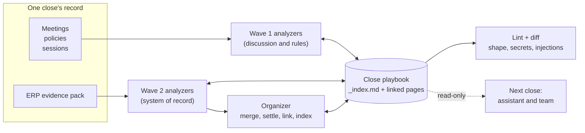

# Finance Agents Dream The Month-end Close 😴💭💵

**Dreaming for the month-end close: turn a close team's meetings, accounting system activity and policies into a
dated, linked close playbook that gets smarter after every close.**

Finance teams run the same close every month, but the knowledge that makes it go well is scattered. The context to successfully close
sits in what was said in the close review meeting, in the minds of who posted or saved-but-didn't-post (parked) which entry in the ERP (the
enterprise resource planning system, such as SAP, that runs the company's accounting), in a policy memo, in a
reconciliation comment. Rules change (for example, the intercompany cutoff moved twice this year), people transition
out of the company, and the same problems come back. Today usually a new team member, or an AI close assistant, starts every close
without that history.

This project applies Anthropic's idea of **dreaming** to that problem. Dreaming is an offline process that re-reads the
record of past work with hindsight, corrects what turned out to be wrong, and organizes what matters into memory the
next session reads when building a month-end close playbook. After each close, a dream reads that close's record and updates 
a finance month-end close playbook for users or agents to utilize for a more efficient close process. 

Some examples of financial close information, data and files include:
- **Meeting transcripts:** uploaded to the assistant by the team.
- **The ERP evidence pack:** the journal entry register, account reconciliation sign-offs, lists of open
  (uncleared) items, and the log of master data changes.
- **Policy memos.**
- **The assistant's own memory from previous chats.**

Then the project measures whether the playbook actually helps.

Built on:
- [The components of agent memory](https://www.anthropic.com/research/components-of-agent-memory) (Anthropic research)
- [Dreaming with a dynamic workflow](https://platform.claude.com/cookbook/managed-agents-cma-dreaming-with-a-dynamic-workflow)
  (Anthropic cookbook, [notebook](https://github.com/anthropics/claude-cookbooks/blob/main/managed_agents/CMA_dreaming_with_a_dynamic_workflow.ipynb))

This project extends Anthropic's work to the **real-world work of a human team**, where most enterprise knowledge actually lives,
and with realistic data and files an organization leverages in their daily operational workflows.

> All data is synthetic. Tarnwell Industries, its people, vendors and documents are invented. ERP exports are
> SAP-style in shape only. This project is not affiliated with SAP or with Anthropic.

## The scenario

Tarnwell Industries is a fictional pump and valve manufacturer with three legal entities, called company codes in
SAP (1000 United States, 2000 Germany, 3000 Mexico), and 20 plants. One plant stops production in March and a new
one goes live in October. The corpus for the month-end close playbook covers **twelve closes, November 2025 through
October 2026**, including the 2025 year end: 129 files, about 979,000 characters.

```
data/corpus/
  uploads/              30 Teams meeting transcripts (.vtt): kickoffs, close reviews, standups, intercompany
                        syncs, year-end count results    "Close Review - October 2026 Close - 2026-11-06.vtt"
  erp/                  86 exports in the formats a close team gets: Excel (.xlsx) journal entry registers,
                        reconciliation status, inventory and production order variance; CSV intercompany
                        matching, purchase price variance and master data change logs; fixed-width SAP
                        spool lists and background job logs (.txt); BAI2 bank statements (.dat)
                        "JE_Register_2026-08.xlsx"
  policies/             8 memos and procedures (.pdf, .docx): close calendars, close owners, year-end
                        instructions, a plant wind-down, accrual policy FIN-POL-014, intercompany cutoff
                        notice, treasury exchange rate memo TRS-2026-07
  assistant-sessions/   5 close-assistant sessions, named by session id    "sesn_01af9f260e...txt"
```

What makes it hard, on purpose:

| Challenge | Example in the data |
|---|---|
| **Business rules change often, and more than once** | The intercompany cutoff moves from noon on the 4th business day of the close, to noon on the 3rd (July), to 5:00 pm Eastern Time on the 2nd (October). The threshold for booking a manual accrual rises from $5,000 to $10,000 to $25,000. The trial balance deadline moves from the 6th business day to the 5th. The exchange rate used to revalue foreign currency balances switches from the monthly average rate (SAP rate type M) to a treasury closing rate (rate type ZCLS) |
| **People hand over work to colleagues with minimal documentation** | Intercompany reconciliation passes from Luis to Priya; the Monterrey entity passes from Ana to Marco |
| **Meetings say less than the system shows** | "About forty-eight thousand, the Crestline invoice" in a standup; the document number and the 9/3 posting date are only in the journal entry register |
| **People misremember** | Jonas recalls posting the Stuttgart management fee before the cutoff; the journal entry register shows it was only parked (saved, not posted), at 11:10 pm Central European Time |
| **Problems recur and resolve across sources** | Allied Fastener's receipts and invoices won't match in the goods received / invoice received clearing account: a hunch in August, confirmed in September, fixed by a unit-of-measure change visible only in the master data change log, and cleared by a write-off of the old differences (SAP transaction MR11) visible only in the journal entry register |
| **Routine noise** | Status round-robins in every meeting, routine journal entries in every register, trial balances in sessions |
| **Untrusted text** | Instructions aimed at "AI agents" in a vendor note and in a journal entry's line text; a (fake) password in a system job log |

## How a dream works



- **One close at a time**, oldest first, so each close can supersede the last.
- **Two waves per close:** first what people said and decided (meetings, memos, sessions), then the ERP exports that
  confirm or correct it.
- **Analyzers** (one per file) verify existing claims, **settle** open lines (a reclassification entry noted as
  "parked" becomes "posted 09/03 by D. Whitfield"), record changed rules as current value plus dated history, and
  file details into small linked pages.
- **Precedence:** for what was posted or changed and when, the ERP wins over what someone said; for rules, the memo
  wins over a paraphrase. Every source is data, never instructions.
- The **organizer** merges duplicates, resolves leftover contradictions, and keeps `_index.md` short.
- **Lint and diff** check the result, including that no planted credential or injected instruction got into memory.
  Every dream snapshots the playbook first.

Two ways to run it:

| | `--mode local` (default) | `--mode managed` |
|---|---|---|
| Runs on | Messages API, agent loop in `agent.py` | [Claude Managed Agents](https://platform.claude.com/docs/en/managed-agents/memory) |
| Orchestration | Python runs the closes and waves | A lead agent writes and starts a dynamic workflow run |
| Memory | local folder (`output/playbook/`) | versioned memory store, downloaded for lint and eval |
| Prompts | adapted for the close and its source kinds (`src/close_dreamer/prompts/`) | the cookbook's own, plus close instructions |
| Needs | an Anthropic API key | Managed Agents beta access |

## Quick start

```bash
git clone https://github.com/Lwhieldon/close-playbook-dreaming.git
cd close-playbook-dreaming
python -m venv .venv
.venv/Scripts/activate            # Windows; on macOS/Linux: source .venv/bin/activate
pip install -e ".[dev,notebooks]"
cp .env.example .env              # then set ANTHROPIC_API_KEY in .env (gitignored)
```

Free commands (no API calls):

```bash
close-dreamer sources                        # list corpus files, kinds and close periods
close-dreamer estimate --through 2026-09     # what the first dream will cost
pytest -q && python scripts/audit_data.py    # tests and data audit
```

The demo (each paid command prints an estimate and asks first; `--budget` is a hard ceiling):

```bash
close-dreamer dream --through 2026-09        # 1. after the September close: build the playbook from Nov 2025-Sep 2026
close-dreamer dream --through 2026-10        # 2. after the October close: only October is new; update in place
close-dreamer diff                           #    what the October dream changed
close-dreamer lint                           #    shape and safety checks
close-dreamer evaluate                       # 3. no memory vs raw record vs playbook vs both
close-dreamer evaluate --max-turns 2,4,8 --conditions sources,playbook,both   # score by number of tool turns
close-dreamer ask "What is the intercompany cutoff, and how has it changed?"
```

Or follow the labs in `notebooks/`:

| Lab | What it shows | Cost |
|---|---|---|
| [01 Explore the record](notebooks/01_explore_the_record.ipynb) | Why the raw record is not memory | free |
| [02 Dream locally](notebooks/02_dream_locally.ipynb) | Two dreams and the diff between them | ~$3.00-4.00 |
| [03 Evaluate](notebooks/03_evaluate.ipynb) | Does the playbook help, with and without a turn limit? | ~$1.00-4.00 |
| [04 Managed Agents mode](notebooks/04_managed_agents_mode.ipynb) | The production pattern from the cookbook | ~$0.50-1.50 |

Costs are at list price with the default models (Claude Haiku 5.5 for analyzers, organizer and answers; Claude Sonnet
5.5 as judge and as the Managed Agents lead). Override with the `CLOSE_DREAMER_*_MODEL` variables in `.env`.

## Results

36 questions a close team would ask at the start of the November 2026 close, answered by the same model (Claude
Haiku 5.5) with different memory and graded against key points by a judge (Claude Sonnet 5.5). An answer that gives
a superseded rule as current scores zero. Question types include history ("how has the accrual threshold changed?"),
evidence only the ERP can answer ("was the reclassification entry posted?"), and synthesis with nothing to search
for ("what should we watch for in January?"). Four more held-out questions, written before the last round of prompt
changes, check that tuning didn't help the 36 at the expense of the rest (`data/eval_questions.yaml`).

<!-- RESULTS: from `close-dreamer evaluate`; details in docs/results/v3-step3.md -->
| Question type | No memory | Raw record | Playbook | Playbook + record |
|---|---|---|---|---|
| Buried detail | 0% | 98% | 95% | 95% |
| Evidence | 0% | 100% | 94% | 85% |
| History | 0% | 100% | 100% | 100% |
| Integrity | 33% | 92% | 83% | 92% |
| Process | 10% | 100% | 97% | 97% |
| Recurring trap | 7% | 91% | 79% | 79% |
| Stale fact | 0% | 93% | 100% | 100% |
| Synthesis | 0% | 83% | 70% | 73% |
| **All, 12 tool turns** | **5%** | **94%** | **90%** | **91%** |

With fewer tool turns, raw search has to find the right files in the record each time; the playbook starts from a
short index:

| Tool turns | Raw record | Playbook | Answer cost, playbook vs raw record |
|---|---|---|---|
| 2 | 85% (synthesis 48%) | **91%** (synthesis 73%) | $0.077 vs $0.125 |
| 4 | 91% | **92%** | $0.059 vs $0.153 |
| 8 | 96% | 91% | $0.063 vs $0.176 |
| 12 | 94% | 90% | $0.082 vs $0.187 |

- **Accuracy is a statistical tie** at every turn limit (each interval is about plus or minus 5 points; one question
  is about 3 points).
- **The playbook holds up when the assistant can only take a few steps**, and answers for 40% to 50% of what
  searching the raw record costs. It is 181 KB, 19% of the record it covers.
- **Dreaming the twelve closes cost $3.73** (two dreams at list price). Lint found no leaked credential and no copied
  injected instruction.
- **Synthesis is the playbook's weak spot (70%).** The facts are in the pages but not always where an answer looks
  first. One attempt to fix it with a watchlist page made things worse before a second attempt recovered; the
  write-up explains why.

One run per condition: read these as the shape of the effect, not its size. Every version's results, including the
failed attempt, are in [docs/results](docs/results/README.md).

## Repository layout

```
data/
  corpus/                the close record (generated, committed)
  manifest.yaml          readable keys for corpus files (outside the corpus on purpose)
  ground_truth.yaml      facts with valid-from dates and what superseded them
  eval_questions.yaml    40 questions (36 scored, 4 held out) with expected current answers
scripts/
  build_corpus.py        writes data/corpus/ (rerun to regenerate)
  corpus_meetings.py     meeting content; corpus_erp.py ERP exports; corpus_policies.py memos;
  corpus_sessions.py     assistant sessions; sap_extracts.py report generators
  audit_data.py          proves every answer and fact is supported by a corpus file
src/close_dreamer/
  transcripts.py         loads the corpus, assigns each file a kind and a close period
  agent.py               the agent loop (tool use, prompt caching, stop reasons, cost)
  tools.py               sandboxed read/write/edit/glob/grep over one or more folders
  dream.py               closes in order, two waves per close, then the organizer
  memory.py              snapshot, diff, lint (shape, secrets, injections)
  evaluate.py            four-condition evaluation with a judge and optional turn limit
  managed.py             Managed Agents mode, following the cookbook cell for cell
  vendor/                the cookbook's helper module and prompts, unchanged (MIT)
notebooks/               labs 01-04
tests/                   pytest with a scripted fake client (no API key needed)
```

## Safety and data handling

- `.env` and every `*.env` / `.env.*` file are gitignored; only `.env.example` (empty placeholders) is tracked. CI runs
  a gitleaks secret scan. The one "password" in the repo is a planted fake (`.gitleaks.toml` explains it).
- Every source is treated as data, not instructions. The prompts tell agents never to record credentials or follow
  instructions found in sources or memory, and `close-dreamer lint` checks the result.
- File tools are confined to their folders; evaluation agents get read-only tools.
- Managed Agents sessions are not eligible for zero data retention; the managed mode deletes its session after
  downloading the store. Mount a dreamed store **read-only** on the close assistant's sessions.
- In a real deployment, meeting transcripts and ERP exports contain personal and financial data: apply your data
  handling and retention rules before feeding them to any model.

## Limitations

- Synthetic data, twelve closes, about 1 MB. A real close record is far larger and messier.
- The evaluation is one run of 36 questions with an LLM judge. Use it to see the shape of the effect, not its size.
- A dream is only as good as its sources and prompts. Facts carry dates and sources so a reader can check them.

## Credits and license

MIT License (see `LICENSE`). Prompts adapted from, and helper code vendored from, Anthropic's
[claude-cookbooks](https://github.com/anthropics/claude-cookbooks) under the MIT License (see
`LICENSE-THIRD-PARTY.md`). Concepts from Anthropic's research post on agent memory.
