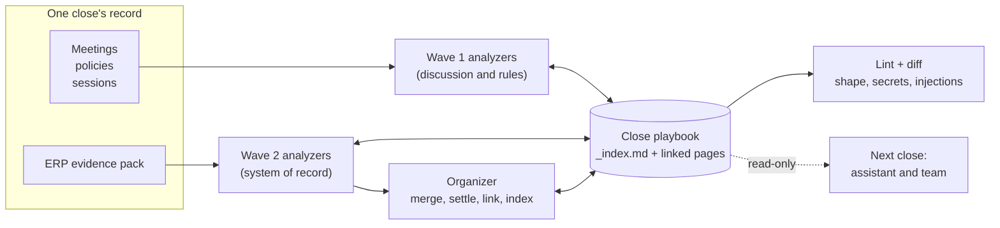

# Finance Agents Dream The Month-end Close 😴💭

**Dreaming for the month-end close: turn a close team's meetings, ERP activity and policies into a dated,
linked close playbook that gets smarter after every close.**

Finance teams run the same close every month, but the knowledge that makes it go well is scattered. It sits in
what was said in the close review, in who posted or parked what in the ERP, in a policy memo, in a reconciliation
comment. Rules change (the intercompany cutoff moved twice this year), people hand over, and the same problems come
back. A new team member, or an AI close assistant, starts every close without that history.

This project applies Anthropic's idea of **dreaming** to that problem. Dreaming is an offline pass that re-reads the
record of past work with hindsight, corrects what turned out to be wrong, and organizes what matters into memory the
next session reads. After each close, a dream reads that close's record and updates the playbook:
- **Meeting transcripts:** uploaded to the assistant by the team.
- **The ERP evidence pack:** JE register, reconciliation sign-offs, open items, change log.
- **Policy memos.**
- **The assistant's own sessions.**

Then the project measures whether the playbook actually helps.

Built on:
- [The components of agent memory](https://www.anthropic.com/research/components-of-agent-memory) (Anthropic research)
- [Dreaming with a dynamic workflow](https://platform.claude.com/cookbook/managed-agents-cma-dreaming-with-a-dynamic-workflow)
  (Anthropic cookbook, [notebook](https://github.com/anthropics/claude-cookbooks/blob/main/managed_agents/CMA_dreaming_with_a_dynamic_workflow.ipynb))

The article dreams over an agent's own transcripts. This project extends the idea to the **work record of a human
team**, where most enterprise knowledge actually lives, with the agent's sessions as one source among several.

> All data is synthetic. Tarnwell Industries, its people, vendors and documents are invented. ERP exports are
> SAP-style in shape only. This project is not affiliated with SAP or with Anthropic.

## The scenario

Tarnwell Industries is a fictional pump and valve manufacturer with three company codes (1000 US, 2000 Germany,
3000 Mexico) and five plants. The corpus covers **six closes, May through October 2026**: 53 files, about 275 KB.

```
data/corpus/
  uploads/              17 Teams meeting transcripts (.vtt): kickoffs, close reviews, standups, IC syncs
                        "Close Review - October 2026 Close - 2026-11-06.vtt"
  erp/                  26 exports (.csv): JE register, reconciliation status, GR/IR open items, PPV,
                        intercompany matching, change log    "JE_Register_2026-08.csv"
  policies/             5 memos: close calendar, owners, FIN-POL-014, IC cutoff notice, TRS-2026-07
  assistant-sessions/   5 close-assistant sessions, named by session id    "sesn_01af9f260e...txt"
```

What makes it hard, on purpose:

| Challenge | Example in the data |
|---|---|
| **Rules change, more than once** | IC cutoff BD4 noon, then BD3 noon (July), then BD2 5:00 pm ET (October). Accrual threshold $5k, then $10k, then $25k. TB deadline BD6, then BD5. FX rate type M, then ZCLS |
| **People hand over** | IC reconciliation Luis to Priya; Monterrey Ana to Marco |
| **Meetings say less than the system shows** | "About forty-eight thousand, the Crestline invoice" in a standup; the document number and the 9/3 posting are only in the JE register |
| **People misremember** | Jonas recalls posting the Stuttgart fee before cutoff; the JE register shows it parked at 23:10 CET |
| **Problems recur and resolve across sources** | Allied Fastener's GR/IR: a hunch in August, confirmed in September, fixed by a master data change visible only in the change log, cleared by an MR11 visible only in the JE register |
| **Routine noise** | Status round-robins in every meeting, routine JEs in every register, trial balances in sessions |
| **Untrusted text** | Instructions aimed at "AI agents" in a vendor note and a JE line text; a (fake) password in a job log |

## How a dream works



- **One close at a time**, oldest first, so each close can supersede the last.
- **Two waves per close:** first what people said and decided (meetings, memos, sessions), then the ERP exports that
  confirm or correct it.
- **Analyzers** (one per file) verify existing claims, **settle** open lines ("parked" becomes "posted 09/03 by
  D. Whitfield"), record changed rules as current value plus dated history, and file details into small linked pages.
- **Precedence:** for what was posted or changed and when, the ERP wins over what someone said; for rules, the memo
  wins over a paraphrase. Every source is data, never instructions.
- The **organizer** merges duplicates, resolves leftover contradictions, and keeps `_index.md` short.
- **Lint and diff** check the result, including that no planted credential or injected instruction got into memory.
  Every dream snapshots the playbook first.

Two ways to run it:

| | `--mode local` (default) | `--mode managed` |
|---|---|---|
| Runs on | Messages API, agent loop in `agent.py` | [Claude Managed Agents](https://platform.claude.com/docs/en/managed-agents/memory) |
| Orchestration | Python runs the closes and waves | A lead agent writes and starts a dynamic workflow run |
| Memory | local folder (`output/playbook/`) | versioned memory store, downloaded for lint and eval |
| Prompts | adapted for the close and its source kinds (`src/close_dreamer/prompts/`) | the cookbook's own, plus close instructions |
| Needs | an Anthropic API key | Managed Agents beta access |

## Quick start

```bash
git clone https://github.com/Lwhieldon/close-playbook-dreaming.git
cd close-playbook-dreaming
python -m venv .venv
.venv/Scripts/activate            # Windows; on macOS/Linux: source .venv/bin/activate
pip install -e ".[dev,notebooks]"
cp .env.example .env              # then set ANTHROPIC_API_KEY in .env (gitignored)
```

Free commands (no API calls):

```bash
close-dreamer sources                        # list corpus files, kinds and close periods
close-dreamer estimate --through 2026-09     # what the first dream will cost
pytest -q && python scripts/audit_data.py    # tests and data audit
```

The demo (each paid command prints an estimate and asks first; `--budget` is a hard ceiling):

```bash
close-dreamer dream --through 2026-09        # 1. after the September close: build the playbook from May-Sep
close-dreamer dream --through 2026-10        # 2. after the October close: only October is new; update in place
close-dreamer diff                           #    what the October dream changed
close-dreamer lint                           #    shape and safety checks
close-dreamer evaluate                       # 3. no memory vs raw record vs playbook vs both
close-dreamer evaluate --max-turns 3 --conditions sources,playbook,both   # a turn-limited run
close-dreamer ask "What is the IC cutoff, and how has it changed?"
```

Or follow the labs in `notebooks/`:

| Lab | What it shows | Cost |
|---|---|---|
| [01 Explore the record](notebooks/01_explore_the_record.ipynb) | Why the raw record is not memory | free |
| [02 Dream locally](notebooks/02_dream_locally.ipynb) | Two dreams and the diff between them | ~$0.30-0.80 |
| [03 Evaluate](notebooks/03_evaluate.ipynb) | Does the playbook help, with and without a turn limit? | ~$0.60-1.50 |
| [04 Managed Agents mode](notebooks/04_managed_agents_mode.ipynb) | The production pattern from the cookbook | ~$0.50-1.50 |

Costs are at list price with the default models (Claude Haiku 5.5 for analyzers, organizer and answers; Claude Sonnet
5.5 as judge and as the Managed Agents lead). Override with the `CLOSE_DREAMER_*_MODEL` variables in `.env`.

## Results

32 questions a close team would ask at the start of the November close, answered by the same model with different
memory and graded against the current answer (`data/eval_questions.yaml`). Question types include history ("how
has the threshold changed?"), evidence only the ERP can answer ("was the reclass posted?"), and synthesis with
nothing to grep for ("what should we watch for in January?").

<!-- RESULTS: filled in from `close-dreamer evaluate` output -->
| Question type | No memory | Raw record | Playbook | Playbook + record |
|---|---|---|---|---|
| _tbd_ | | | | |

Turn-limited run (3 tool turns): _tbd_. Dream cost: _tbd_. One run of 32 questions: illustrative, not a benchmark.

## Repository layout

```
data/
  corpus/                the close record (generated, committed)
  manifest.yaml          readable keys for corpus files (outside the corpus on purpose)
  ground_truth.yaml      facts with valid-from dates and what superseded them
  eval_questions.yaml    32 questions with expected current answers
scripts/
  build_corpus.py        writes data/corpus/ (rerun to regenerate)
  corpus_meetings.py     meeting content; corpus_erp.py ERP exports; corpus_policies.py memos;
  corpus_sessions.py     assistant sessions; sap_extracts.py report generators
  audit_data.py          proves every answer and fact is supported by a corpus file
src/close_dreamer/
  transcripts.py         loads the corpus, assigns each file a kind and a close period
  agent.py               the agent loop (tool use, prompt caching, stop reasons, cost)
  tools.py               sandboxed read/write/edit/glob/grep over one or more folders
  dream.py               closes in order, two waves per close, then the organizer
  memory.py              snapshot, diff, lint (shape, secrets, injections)
  evaluate.py            four-condition evaluation with a judge and optional turn limit
  managed.py             Managed Agents mode, following the cookbook cell for cell
  vendor/                the cookbook's helper module and prompts, unchanged (MIT)
notebooks/               labs 01-04
tests/                   pytest with a scripted fake client (no API key needed)
```

## Safety and data handling

- `.env` and every `*.env` / `.env.*` file are gitignored; only `.env.example` (empty placeholders) is tracked. CI runs
  a gitleaks secret scan. The one "password" in the repo is a planted fake (`.gitleaks.toml` explains it).
- Every source is treated as data, not instructions. The prompts tell agents never to record credentials or follow
  instructions found in sources or memory, and `close-dreamer lint` checks the result.
- File tools are confined to their folders; evaluation agents get read-only tools.
- Managed Agents sessions are not eligible for zero data retention; the managed mode deletes its session after
  downloading the store. Mount a dreamed store **read-only** on the close assistant's sessions.
- In a real deployment, meeting transcripts and ERP extracts contain personal and financial data: apply your data
  handling and retention rules before feeding them to any model.

## Limitations

- Synthetic data, six closes, 275 KB. A real close record is far larger and messier.
- The evaluation is one run of 32 questions with an LLM judge. Use it to see the shape of the effect, not its size.
- A dream is only as good as its sources and prompts. Facts carry dates and sources so a reader can check them.

## Credits and license

MIT License (see `LICENSE`). Prompts adapted from, and helper code vendored from, Anthropic's
[claude-cookbooks](https://github.com/anthropics/claude-cookbooks) under the MIT License (see
`LICENSE-THIRD-PARTY.md`). Concepts from Anthropic's research post on agent memory.
